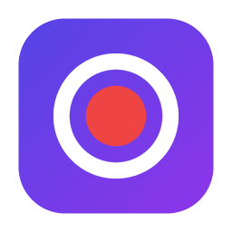
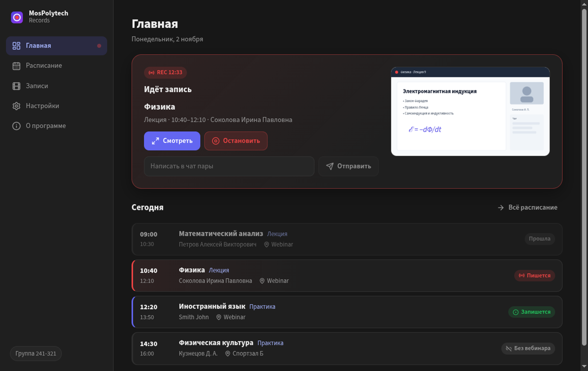
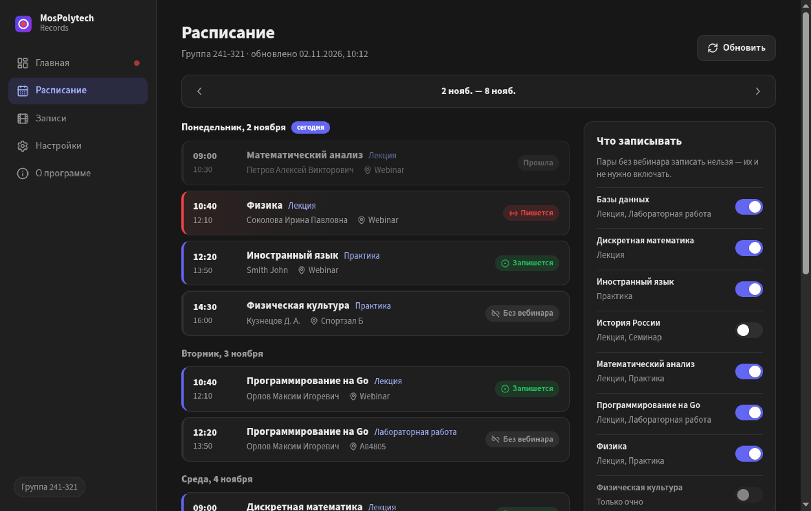
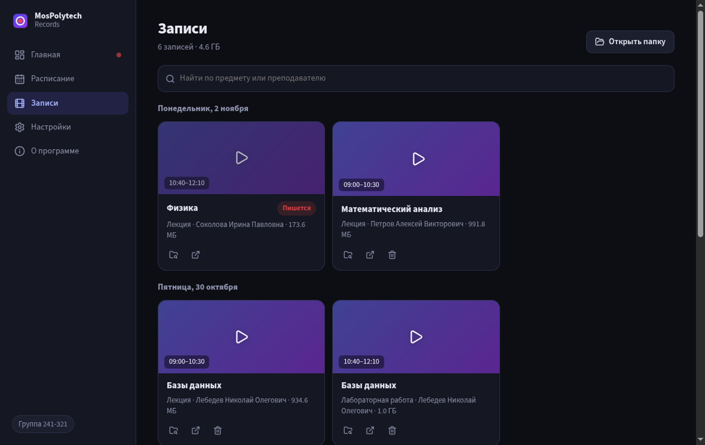
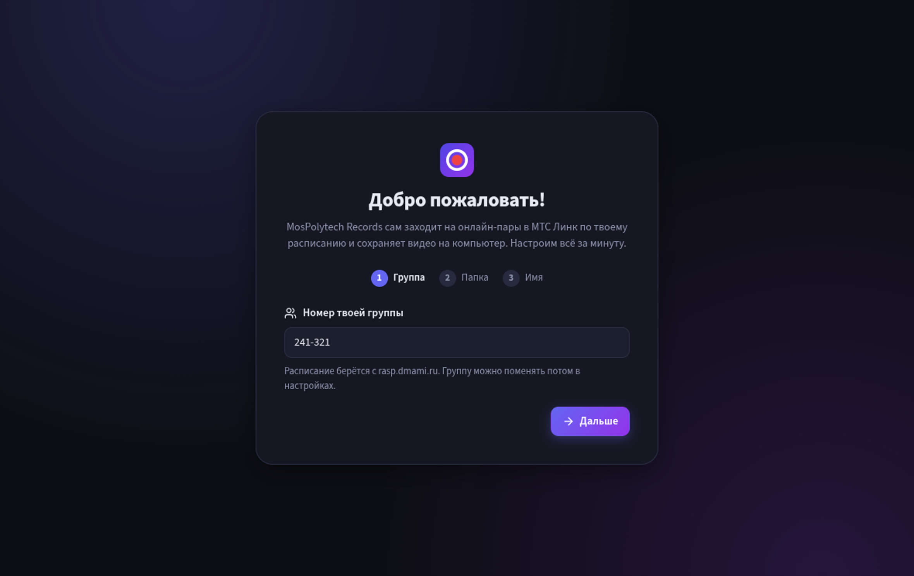
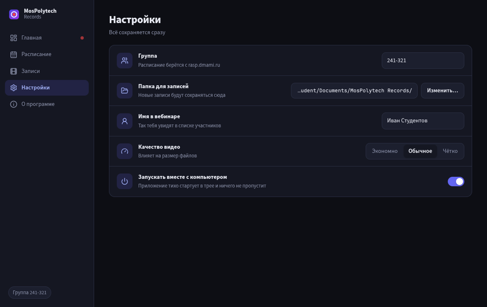
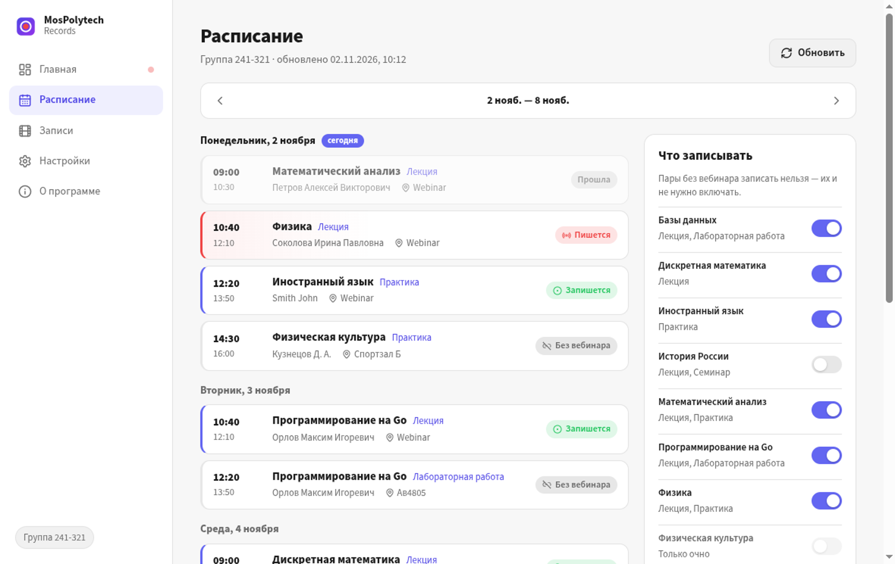

<div align="center">



# MosPolytech Records

**Автоматическая запись лекций Московского Политеха. Сам заходит на онлайн-пары Мосполитеха и записывает их — пока вы спите, едете или заняты.**

Выберите группу один раз. Дальше приложение тихо живёт в трее, смотрит расписание
на [rasp.dmami.ru](https://rasp.dmami.ru), подключается к вебинарам МТС Линк и сохраняет видео
на ваш компьютер. Никаких серверов, аккаунтов и подписок.

[](https://github.com/set-night/mospolytech-records/releases/latest)
[](https://github.com/set-night/mospolytech-records/releases)
[](https://github.com/set-night/mospolytech-records/actions/workflows/ci.yml)
[](LICENSE)

<br />

### Скачать

[](https://github.com/set-night/mospolytech-records/releases/latest/download/MosPolytech-Records-Setup-x64.exe)
[](https://github.com/set-night/mospolytech-records/releases/latest/download/MosPolytech-Records-arm64.dmg)
[](https://github.com/set-night/mospolytech-records/releases/latest/download/MosPolytech-Records-x64.dmg)
[](https://github.com/set-night/mospolytech-records/releases/latest/download/MosPolytech-Records-x86_64.AppImage)

<sub><a href="https://set-night.github.io/mospolytech-records/">Сайт проекта</a> · Другие форматы — <a href="https://github.com/set-night/mospolytech-records/releases/latest/download/MosPolytech-Records-x64.msi">.msi</a> для Windows и
<a href="https://github.com/set-night/mospolytech-records/releases/latest/download/MosPolytech-Records-amd64.deb">.deb</a> для Ubuntu/Debian — и все версии на странице
<a href="https://github.com/set-night/mospolytech-records/releases">релизов</a>.</sub>

<br /><br />



</div>

## Что умеет

- 🗓️ **Красивое расписание** вашей группы на неделю — прямо из rasp.dmami.ru, работает и без интернета.
- 🔴 **Записывает сам.** За 5 минут до пары заходит в вебинар, ждёт преподавателя и пишет видео со звуком.
- 🙈 **Незаметно.** Окно вебинара скрыто, звук не играет — можно спокойно пользоваться компьютером.
- 🎚️ **Вы решаете, что записывать.** Переключатель у каждого предмета; любую идущую пару можно записать вручную.
- 🎞️ **Встроенный просмотр.** Все записи по датам, поиск по предмету и преподавателю, плеер внутри приложения.
- 💾 **Всё у вас.** Видео лежат в папке «Документы/MosPolytech Records» как обычные .mp4.
- 🔔 **Держит в курсе.** Уведомит, когда запись сохранена, если пару записать не вышло и когда кончается место на диске.
- 🧹 **Следит за местом.** По желанию сам убирает в корзину записи старше месяца, трёх или шести месяцев.
- 🚀 **Автозапуск** вместе с системой и **обновления в фоне** — новая версия ставится одним перезапуском, никогда во время пары.

## Как пользоваться

1. **Скачайте** установщик для своей системы по кнопке выше и установите как обычную программу.
2. **Введите номер группы**, например `241-321`, и имя, под которым приложение будет заходить в вебинар.
3. **Всё.** Значок появится в трее (рядом с часами). Компьютер должен быть включён и не спать во время пары.

<table>
  <tr>
    <td></td>
    <td></td>
  </tr>
  <tr>
    <td align="center"><b>Расписание</b> и выбор предметов</td>
    <td align="center"><b>Записи</b> с поиском и плеером</td>
  </tr>
  <tr>
    <td></td>
    <td></td>
  </tr>
  <tr>
    <td align="center"><b>Первый запуск</b> — одна минута</td>
    <td align="center"><b>Настройки</b>: папка, качество, автозапуск</td>
  </tr>
</table>

<details>
<summary><b>Светлая тема</b> включается вместе с системной</summary>
<br />

</details>

## Частые вопросы

<details>
<summary><b>Windows пишет «Система Windows защитила ваш компьютер»</b></summary>

Приложение бесплатное и не подписано платным сертификатом. Нажмите **«Подробнее» → «Выполнить в любом случае»**.
</details>

<details>
<summary><b>macOS пишет, что приложение «повреждено» или «от неустановленного разработчика»</b></summary>

Откройте «Программы», нажмите на MosPolytech Records **правой кнопкой → «Открыть»** и подтвердите.
Если не помогло — выполните в Терминале:

```bash
xattr -cr "/Applications/MosPolytech Records.app"
```
</details>

<details>
<summary><b>Как запустить AppImage на Linux?</b></summary>

Сделайте файл исполняемым (`chmod +x MosPolytech-Records-x86_64.AppImage`) и запустите. На Ubuntu 24.04+
может понадобиться пакет `libfuse2t64`. Проще — поставить .deb.
</details>

<details>
<summary><b>Пара прошла, а записи нет</b></summary>

Проверьте, что у пары есть ссылка на вебинар (в расписании нет плашки «Без вебинара»), предмет включён,
а компьютер не уходил в сон. Приложение само повторно проверяет расписание, если ссылку добавили в последний момент.
Если всё так, а записи нет — откройте «О приложении» → «Журнал работы» и приложите файл `app.log` к
[issue](https://github.com/set-night/mospolytech-records/issues/new/choose).
</details>

<details>
<summary><b>Сколько места занимают записи?</b></summary>

Около 0,5 / 1 / 2 ГБ за пару в режимах «Экономно», «Обычное» и «Чётко». Качество меняется в настройках,
там же видно, сколько места свободно и на сколько пар его хватит. Там же можно включить автоочистку:
старые записи уйдут в корзину (файлы, которые вы положили в папку сами, приложение не трогает).
</details>

<details>
<summary><b>Как обновиться?</b></summary>

Если вы ставили приложение через Windows-установщик `.exe` или запускаете AppImage — ничего делать не нужно:
новая версия скачается в фоне, а приложение предложит перезапуститься (на главной и в меню трея).
Для `.msi`, `.deb` и macOS на вкладке «О приложении» появится кнопка «Скачать» — установите новую версию поверх,
записи и настройки сохранятся.
</details>

<details>
<summary><b>Это безопасно? Куда уходят данные?</b></summary>

Никуда. Приложение обращается только к rasp.dmami.ru (расписание), к МТС Линк (сам вебинар) и к GitHub
(проверка и загрузка новой версии). Записи и настройки хранятся только на вашем компьютере. Код открыт — можно проверить.
</details>

> [!NOTE]
> Это неофициальный студенческий проект, он не связан с Московским Политехом и МТС Линк.
> Записывайте занятия ответственно и уважайте правила вуза и преподавателей.

## Для разработчиков

Electron + React + TypeScript, сборка — electron-vite, установщики — electron-builder.

```bash
npm install
npm run dev      # приложение с горячей перезагрузкой
npm run check    # линт, типы и тесты — то же, что в CI
npm run dist     # установщики для текущей ОС в dist/
```

Хотите помочь? Загляните в [CONTRIBUTING.md](CONTRIBUTING.md) — там про структуру проекта, тесты и выпуск релизов.
Нашли ошибку или есть идея — [создайте issue](https://github.com/set-night/mospolytech-records/issues/new/choose).

## Лицензия

[MIT](LICENSE) — пользуйтесь, меняйте и делитесь свободно.
